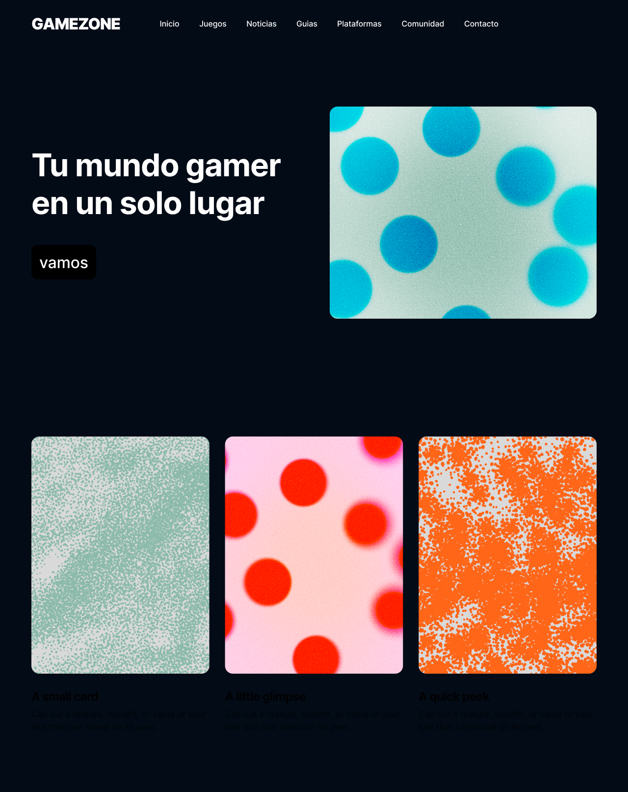
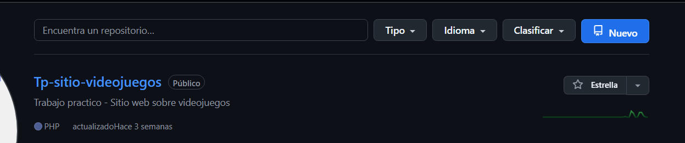
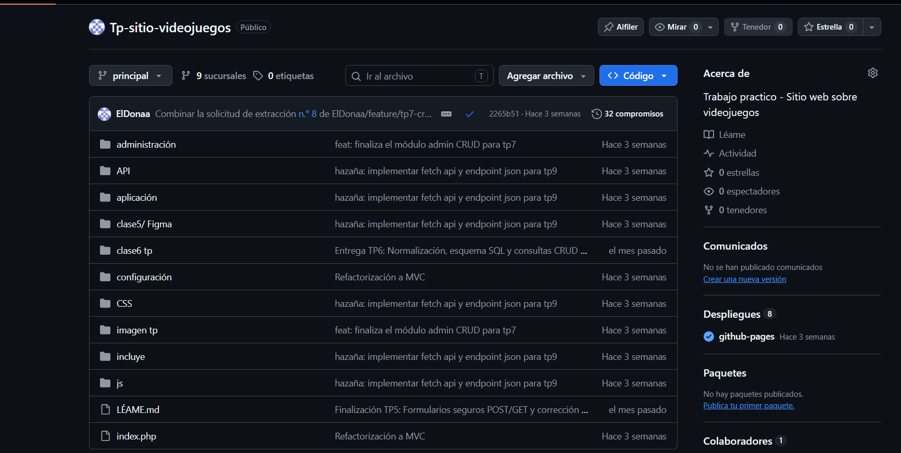
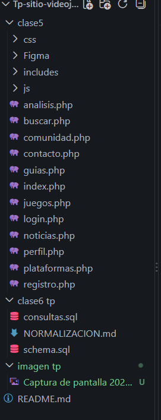
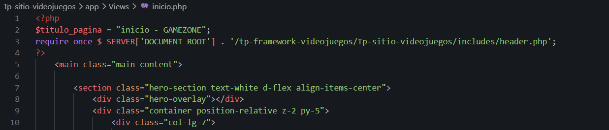
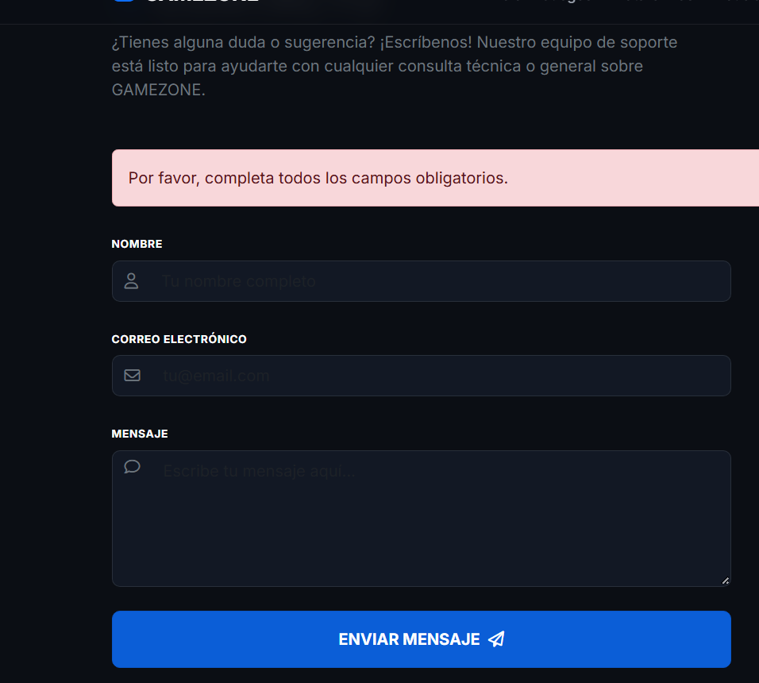
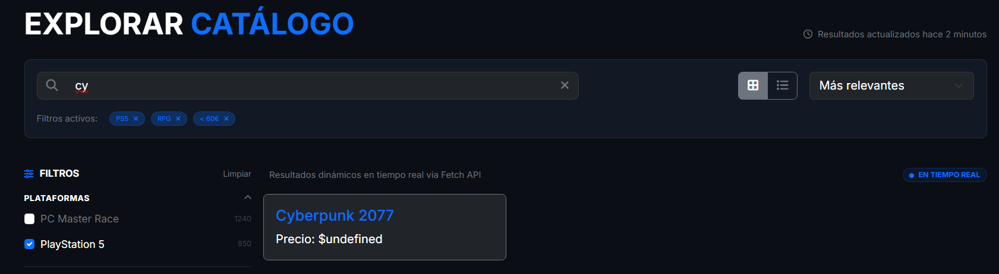
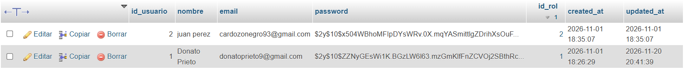

# GameZone - Portal de Videojuegos (`Tp-sitio-videojuegos`)

## Tecnologías Utilizadas

* **Diseño y Prototipado:** Figma.
* **Frontend:** HTML5, CSS3, Bootstrap 5, JavaScript (ES6+).
* **Backend:** PHP 8+, PDO (PHP Data Objects), Manejo de Sesiones (`$_SESSION`).
* **Base de Datos:** MySQL / MariaDB (`gamezone_db`).
* **Control de Versiones y Calidad:** Git, GitHub (ramas `feature/*` y Pull Requests), Prettier, Chrome DevTools (Lighthouse).
* **Despliegue:** GitHub Pages (estático) e InfinityFree mediante FTP / WinSCP (dinámico).

---

## Evolución del Proyecto por Trabajos Prácticos

### TP 1 y TP 2: Wireframes y Diseño UI/UX en Figma
* Definición de la estructura visual inicial mediante wireframes.
* Diseño de mockups de alta fidelidad en **Figma** cubriendo las secciones principales del portal (`inicio`, `juegos`, `noticias`, `guías`, `análisis`, `plataformas`, `comunidad`, `buscar`, `contacto`, `login`, `registro`, `perfil`).
* Exportación de pantallas de diseño al repositorio.



 

---

### TP 3: Maquetación Web, Git Flow y Auditoría Lighthouse
* Inicialización del repositorio local con `git init` y organización base de directorios (`css/`, `js/`, `img/`).
* Desarrollo sobre la rama dedicada `feature/maquetacion` integrando HTML5 semántico, Bootstrap 5 y estilos propios (`css/styles.css`).
* Formateo estandarizado del código con **Prettier**.
* Ejecución de auditoría de calidad y accesibilidad con **Lighthouse** en Chrome DevTools, corrigiendo contrastes, etiquetas y atributos ARIA, documentado en el repositorio.
* Integración hacia `main` mediante **Pull Request** y publicación estática inicial en **GitHub Pages**.



---

### TP 4: Migración a PHP, Modularización (SSI) y Renderizado Server-Side (SSR)
* Migración de vistas estáticas `.html` a archivos dinámicos `.php` ejecutados sobre servidor local (XAMPP).
* Implementación de arquitectura modular extrayendo componentes reutilizables (`header.php`, `nav.php`, `footer.php`) incluidos con `require_once` / `include`.
* Gestión dinámica de metadatos (`$titulo_pagina`) y marcado automático de la sección activa (`active`) en la barra de navegación.
* Manejo de configuración mediante variables de entorno (`.env` ignorado en `.gitignore` y plantilla `.env.example` versionada en el repositorio).



---

### TP 5: Procesamiento de Formularios y Seguridad Web
Incorporación de lógica del lado del servidor para el procesamiento seguro de formularios y mitigación contra ataques Cross-Site Scripting (XSS):

* **Formulario de Contacto (`contacto.php` - Método POST):**
  * Validación estricta en servidor (`isset`, `empty`, `filter_var` para formato de correo electrónico).
  * Sanitización de entradas con `trim()` y codificación de salida mediante `htmlspecialchars()`.
  * Retroalimentación visual (alertas de éxito/error) y **persistencia de datos** en los campos ante errores de validación.
* **Formulario de Búsqueda (`buscar.php` / `api/buscar_juegos.php` - Método GET):**
  * Filtrado y consulta del catálogo manteniendo la persistencia del término buscado en la interfaz.






---

### TP 6 y TP 7: Modelado de Base de Datos y Conexión Segura con PDO
* Diseño relacional de la base de datos **`gamezone_db`** en MySQL/MariaDB, estructurando las tablas principales (`juegos`, `usuarios`, `roles`).
* Implementación de la capa de conexión en `config/conexion.php` utilizando **PDO** con manejo de excepciones (`PDOException`) y consultas preparadas (`prepare` / `execute`) para prevenir inyección SQL.


---

### TP 8: Arquitectura MVC y Sistema de Autenticación de Usuarios
Reorganización del proyecto bajo el patrón **Modelo-Vista-Controlador** (`app/Controllers`, `app/Models`, `app/Views`):

* **`UsuarioModel.php` & `AuthController.php`:**
  * Registro de nuevos usuarios (`registro.php`) con hashing seguro de contraseñas mediante `password_hash(..., PASSWORD_BCRYPT)` y asignación por defecto del rol usuario (`id_rol = 2`).
  * Inicio de sesión (`login.php`) con validación mediante `password_verify()`, regeneración del identificador de sesión (`session_regenerate_id(true)`) y almacenamiento en `$_SESSION`.
  * Cierre de sesión seguro (`logout.php`) destruyendo variables y sesión activa.
* **Protección de Rutas (`auth_guard.php`):** Control de acceso para vistas privadas como `perfil.php`.


---

### TP 9: Módulo CRUD de Videojuegos y Control de Acceso por Roles (RBAC)
Desarrollo del sistema de administración para la gestión completa del catálogo de videojuegos sobre la rama `feature/rol-admin`:

* **Operaciones CRUD (`admin/`):**
  * **Leer (`admin/index.php`):** Listado dinámico de videojuegos desde `gamezone_db` mostrando ID, título, calificación y acciones.
  * **Crear (`admin/crear.php`):** Formulario e inserción de nuevos videojuegos en MySQL.
  * **Actualizar (`admin/editar.php`):** Edición de registros existentes precargando sus datos actuales.
  * **Eliminar (`admin/eliminar.php`):** Eliminación controlada de registros de la base de datos.
* **Seguridad y Control de Roles (`admin/auth_admin.php`):**
  * Diferenciación de privilegios entre usuario estándar (`id_rol = 2`) y administrador (`id_rol = 1`).
  * Protección en servidor en todos los endpoints de `admin/` para bloquear accesos directos por URL de usuarios sin permisos.
  * Renderizado condicional en la interfaz pública mostrando insignias y controles de gestión únicamente al perfil administrador.




---

### TP 10: Despliegue en Producción (InfinityFree)
* Creación e importación de la base de datos `gamezone_db` en el servidor remoto de **InfinityFree**.
* Adaptación de credenciales de conexión a entorno productivo.
* Subida de archivos del proyecto mediante cliente FTP (**WinSCP**) al directorio `htdocs` y verificación integral de funcionamiento online.


---

## Estructura del Proyecto

```text
Tp-sitio-videojuegos/
├── admin/                  # Módulo CRUD protegido para administradores
│   ├── auth_admin.php      # Middleware de verificación de sesión y rol admin (id_rol = 1)
│   ├── crear.php           # Alta de videojuegos
│   ├── editar.php          # Edición de videojuegos
│   ├── eliminar.php        # Baja de videojuegos
│   └── index.php           # Panel principal de gestión CRUD
├── api/                    # Endpoints de consulta y filtrado
│   └── buscar_juegos.php
├── app/                    # Arquitectura MVC
│   ├── Controllers/
│   │   └── AuthController.php
│   ├── Models/
│   │   └── UsuarioModel.php
│   └── Views/              # Vistas del sitio (inicio, juegos, login, registro, perfil, etc.)
├── config/                 # Configuración y conexión PDO a MySQL
├── css/                    # Hojas de estilo personalizadas
├── docs/img/               # Capturas de pantalla para documentación
├── img/                    # Recursos gráficos del sitio
├── js/                     # Scripts del lado del cliente
└── README.md               # Documentación del proyecto